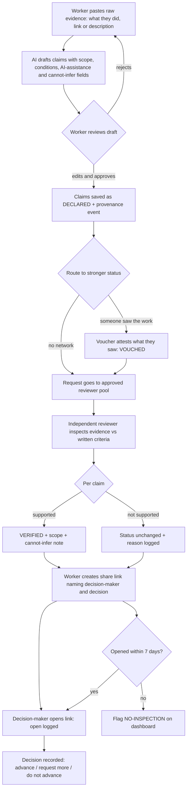
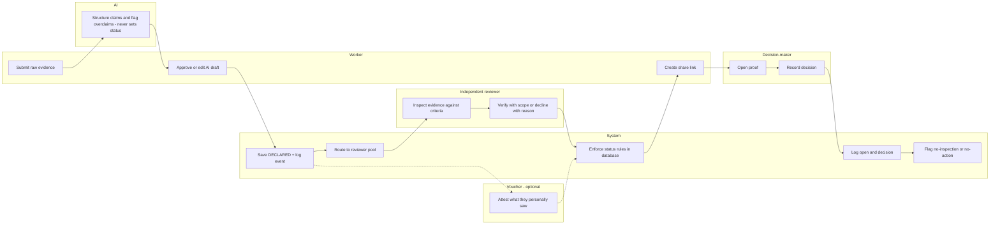
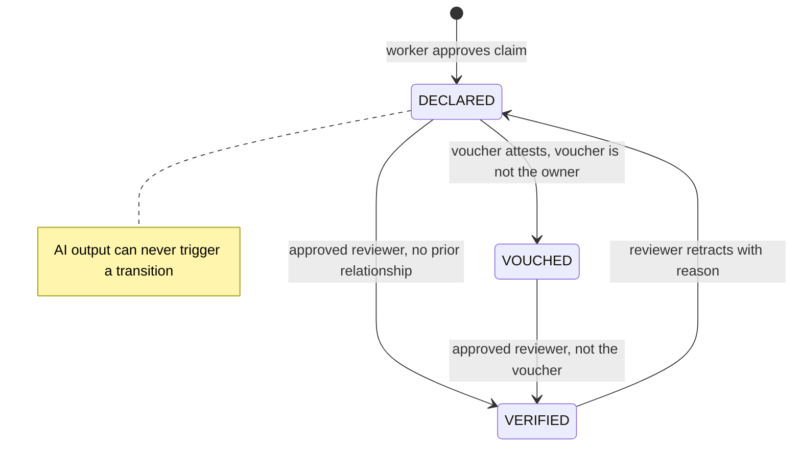

# PACKET — Week 9 · Team 4 · Nicolás Martínez (ADVERSARY)

**Slice:** **Sello** is the proof accountability layer for First-Proof.
**Honors:** Condition 4 (primary) and Condition 1 (status integrity).
**Stack floor:** 🐉 DRAGON. The LLM organizes evidence and flags overclaims. Supabase holds structured, verified data with an append-only provenance log. Automation tracks whether the proof was opened and acted on.

---

## 1. Problem (in my words)

A beginner's evidence fails in two ways, and both kill it before any hiring decision happens:

1. **It is unreadable as trust.** A self-written claim, a friend's recommendation and an independently inspected artifact all look the same on a page. The employer either discounts all of them or believes all of them.
2. **It is never opened.** Most proof systems measure creation and ignore whether anyone read the proof. Evidence that nobody inspects has zero value. This is my preserved dissent and the kill condition for the product.

On top of that, someone without a network has no one credible to vouch for them. A "voucher" feature that only works for people who already have powerful contacts just formalizes inherited social capital.

## 2. Exact user

- **Primary: the worker.** 19–25 years old. Has real capability from informal or family work, for example running orders and inventory for a family taquería over WhatsApp. Has no LinkedIn network and no one "important" to recommend them.
- **Secondary: the independent reviewer.** An approved person with no prior relationship to the worker, such as university faculty or an industry volunteer. They inspect evidence against written criteria.
- **Tertiary: the decision-maker.** An employer or hiring lead with about 2 minutes, who has to choose: advance to interview, request more evidence, or do not advance.

## 3. Success definition

> **Before the module closes, this works:** a worker with no network submits one piece of existing work. The AI structures it into claims, all of which start as DECLARED. An approved reviewer who has never met the worker upgrades **exactly one** claim to VERIFIED, with a written scope and a "cannot infer" note. The worker sends a link that names the decision-maker. The dashboard then shows **sent → opened → decision recorded**. **And** any attempt by the AI or the worker to set a claim to VERIFIED is rejected by the database.

## 4. Mockup (image-generated)

`docs/mockup.png`, generated with this prompt:

> Clean mobile web app screen, 390px wide, light theme, title "Sello · Proof for Lupita R." Below it are three stacked claim cards. Each card has a colored status badge: gray "DECLARED", amber "VOUCHED", green "VERIFIED". The VERIFIED card shows a small line "Scope: observed managing 40 WhatsApp orders over 1 week, reviewer inspected order log" and a grey box labeled "Cannot infer: performance under a POS system or in a team." A small provenance timeline sits under each card: "Declared by worker → AI organized (status unchanged) → Verified by independent reviewer." A banner at the top reads "AI organized this text. AI cannot change any status." At the bottom are three large buttons: "Advance to interview", "Request more evidence", "Do not advance." Minimal, trustworthy, Spanish-Mexican context, sans-serif.

## 5. Flow

### 5a. Flowchart: how the feature works

### 5b. Swimlane: who does what

### 5c. Status rules: the Adversary core

## 6. Benchmark

- **The best existing solution on Earth for this is** Open Badges 3.0 / W3C Verifiable Credentials, as issued through platforms like Credly. These are portable, cryptographically attributable credentials with clear issuer provenance.
- **Mine differs by** working at the level of the **individual claim**, with three visible trust levels, a mandatory scope and "cannot infer" note, a free route to an independent first voucher for people with no network, and tracking of **whether the decision-maker actually opened the proof and acted on it**. Badges certify. Sello measures whether certification changed a decision.

## 7. Long view (light charter)

If this slice works, Sello becomes the trust layer under every First-Proof object. Evidence from family businesses, academic projects and Micro-Experiences would carry an honest status that no AI or self-promotion can inflate. In three years, universities and employers in Mexico would read "VERIFIED, scope: X, cannot infer: Y" as a shared standard, and reviewer pools would be funded by placement outcomes (Inés's question). The open-and-act data becomes the product's conscience: any channel, reviewer or employer segment where proof is never opened gets cut, so the system can't quietly turn into a portfolio nobody reads.

## 8. Scope cut (NOT building this week)

- ❌ Employer accounts or logins. The decision-maker uses a tokenized read-only link.
- ❌ The full employer viewer UX (Santiago), AI-behavior capture (Ana María), funding dashboard (Inés), Micro-Experience workflow (Fernanda). I expose fields they can plug into.
- ❌ Reviewer recruitment, vetting or payment. The pool is 2 seeded, invented reviewers marked `approved = true`.
- ❌ File uploads. Evidence is text plus an optional link, which removes a whole attack surface.
- ❌ Email/WhatsApp sending. The worker copies the link manually.
- ❌ Job listings, matching, CV export. **Forbidden zone.**
- ❌ Cryptographic signing / Open Badges export. Noted for the long view.

## 9. Architecture + stack

| Layer | Choice (free) | Why |
|---|---|---|
| Frontend | Next.js (App Router) on Vercel Hobby | Live URL, API routes, env vars |
| Auth | Supabase Auth, Sign in with Google | Security floor: personal data behind auth |
| DB | Supabase Postgres + RLS | Owners see only their rows; status rules live in the DB |
| Status enforcement | Postgres function `transition_claim_status()` (security definer) + trigger blocking direct `UPDATE` of `status` | Neither the worker nor the AI route can upgrade status, even when calling the API directly |
| LLM | Gemini API free tier, key in Vercel env only | Structures claims and flags overclaims; writes **only** to `ai_drafts` |
| Validation | zod on every form and API route | Length limits; nothing raw into DB or prompt |
| Automation | Vercel Cron (daily) | Marks share links not opened in 7 days as `no_inspection`, and opened but undecided ones as `no_action` |
| Diagrams | Mermaid in this file | Rendered by GitHub |

**Data model**

- `profiles` (id, role: worker | reviewer, approved bool)
- `proofs` (id, owner_id, title, raw_evidence, created_at)
- `claims` (id, proof_id, text, scope, conditions, ai_assistance, revisions, missing_info, cannot_infer, **status** enum DECLARED | VOUCHED | VERIFIED)
- `ai_drafts` (id, proof_id, payload jsonb, overclaim_flags jsonb). The AI writes only here.
- `vouches` (id, claim_id, voucher_name, relationship, what_they_saw)
- `status_events` (id, claim_id, from, to, actor_id, actor_role, reason, created_at). **Append-only, no UPDATE/DELETE policy.**
- `share_links` (id, proof_id, token, decision_maker_label, intended_decision, opened_at, decision, decided_at, flag)

**RLS:** workers CRUD their own `proofs` and `claims` (excluding `status`). Reviewers read only proofs routed to them. `status_events` are insert-only through the function. `share_links` are read by token through a server route, never by public select.

**On-screen labels:** every AI-produced field shows "AI-organized · status unchanged by AI." Seeded demo data shows "Invented demo data."

## 10. Test plan

### 🔧 Mechanical pass

| # | Test | Expected |
|---|---|---|
| 1 | Worker submits evidence, approves the AI draft | All claims are DECLARED, 1 event each |
| 2 | Worker calls `PATCH /claims` with `status: VERIFIED` | Rejected by trigger, no event logged |
| 3 | The AI draft says "verified expert" | Overclaim flagged; status stays DECLARED |
| 4 | Reviewer verifies a claim on a proof they vouched for | Rejected (conflict of interest) |
| 5 | Unapproved reviewer tries to verify | Rejected |
| 6 | Approved, independent reviewer verifies without a scope | Rejected: scope and cannot_infer are required |
| 7 | Valid verification | VERIFIED, event logged with actor and reason |
| 8 | Employer opens share link | `opened_at` set once; reopening doesn't overwrite it |
| 9 | Employer records a decision | `decision` + `decided_at` saved; dashboard shows sent → opened → acted |
| 10 | Tamper with the token | 404, no data leak |
| 11 | Cron on a link older than 7 days and never opened | Flag `no_inspection` visible on dashboard |
| 12 | 10,000-char input in raw evidence | Rejected by zod before reaching DB or prompt |
| 13 | `git grep` for API keys | Zero hits |

At least one bug must be found, fixed and redeployed. Log it in DECISIONS.md.

### 🎭 Persona test

**Worker persona** (fresh chat):
> You are Lupita, 21, from Iztapalapa. For three years you have run the WhatsApp orders and inventory for your family's taquería. You have no LinkedIn, no one in an office who knows you, and you use your phone for everything. You read fast but distrust anything that looks like it will judge you or charge you. If a screen uses words like "verify" or "credential" without explaining them, you assume it isn't for you and you leave quietly.

**Decision-maker persona** (second fresh chat):
> You are Roberto, 38, operations lead at a mid-size logistics company in CDMX. You have 90 seconds per candidate and you're skeptical of anything a candidate wrote about themselves. You'll only advance someone if you can tell at a glance what was actually checked and by whom.

Paste screenshots in order. Ask each persona to attempt the task in character, narrating hesitation and the point where they would quit. Log every confusion and fix the worst one before the deadline.

## 11. Dissent carried into the build

- **Mine:** good evidence does not create value by itself. The dashboard's top metric is **% of sent proofs opened and % acted on**, not proofs created.
- **Santiago's:** the reviewer pool is the default route, not an afterthought, so a worker with zero network can reach VERIFIED.
